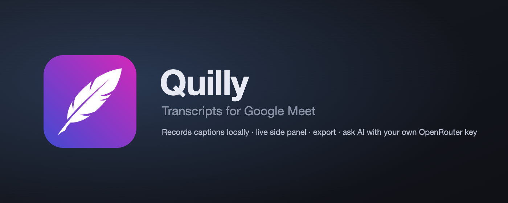

<p align="center">
  
</p>

<p align="center">
  <a href="https://github.com/gegham-khachatryan/quilly/actions/workflows/ci.yml"></a>
  <a href="LICENSE"></a>
  <a href="https://github.com/gegham-khachatryan/quilly/releases"></a>
  <a href="https://gegham-khachatryan.github.io/quilly/privacy"></a>
</p>

**Quilly turns Google Meet's captions into a transcript you own.** It receives the call's live
captions when you join, without switching on Meet's caption band, records every line with the
speaker's name and a timestamp, keeps going while you work in other tabs, and lets you export the result or ask an AI model about it with
your own OpenRouter key. Everything stays in your browser.

## Highlights

- **Live, wherever you are.** The side panel streams the transcript as people speak and follows the active recording across tabs. Hand raises and emoji reactions are logged alongside what was said.
- **Ask AI.** Summary, action items, decisions, a follow-up email, or any question about the meeting. Streaming answers, Markdown rendering, chats saved per session.
- **Every meeting, searchable.** Sessions with search, speaker filter, rename and delete. Export as `.txt`, `.md`, `.json` or copy to the clipboard.
- **Your key, any model.** The picker searches OpenRouter's live catalogue with provider, price and context length. No Quilly account, no server.
- **Local agents.** Claude Code, Cursor, Codex or any MCP client can list, search and read your transcripts through [`quilly-mcp`](packages/quilly-mcp), and follow the meeting being recorded as it happens. Nothing is exported and nothing leaves the computer.

### In detail

- **Auto-start.** Joining a call starts a recording. Auto-start can be disabled; `Alt+Shift+R` toggles recording by hand.
- **Nothing changes in Meet.** Quilly asks Meet's server for captions over the call's own data channel, the way Meet's client does, so the captions button, the caption band and the video layout stay exactly as you left them. Turn Meet's captions on or off for yourself whenever you like; the recording does not depend on it.
- **Caption language.** Settings picks the language the call is transcribed in. Automatic follows the language chosen in Meet's captions during the call, otherwise the browser's.
- **Fallback.** A Meet tab that was already open when Quilly was installed or updated has no hooks on its call, so Quilly switches on Meet's captions there and reads them from the page until the tab is reloaded. In that mode the caption overlay can be hidden (Meet's captions button and the `c` key then show or hide it instead of cutting the transcript source), and a main-world shim keeps Meet rendering captions while its tab is hidden.
- **Hand raises and reactions** are recorded as events in the transcript, exported with it and visible to the AI.
- **Local agents (MCP).** Off by default. Settings issues a pairing token and the one-line `claude mcp add …` command (plus JSON for other clients). The extension looks for a running `quilly-mcp` on localhost every 30 seconds, easing off to every 2 minutes while none is found, and connects to it; both sides prove they hold the token before anything is exchanged. Agents get `list_sessions`, `get_session`, `search_transcripts` and `wait_for_updates`, which blocks until a live recording gains new captions. Read-only.
- **Private by design.** Transcripts, chats and settings live in IndexedDB and `chrome.storage.local`. The only outbound traffic is to OpenRouter, when you ask the AI panel a question, to Google's favicon service for provider logos in the model picker, and to a paired `quilly-mcp` on your own machine if you enable local agents. No analytics. [Privacy policy](https://gegham-khachatryan.github.io/quilly/privacy).

## Install

**Chrome Web Store:** coming soon.

**From source:**

```sh
npm install
npm run build
```

Open `chrome://extensions`, enable *Developer mode*, choose *Load unpacked* and select the `dist/` folder.
Click the toolbar icon to open the side panel. After code changes run `npm run build` again and press
the reload icon on the extension card.

## Development

| Command                   | Purpose                                                              |
| ------------------------- | -------------------------------------------------------------------- |
| `npm run build`           | Pages + service worker (ESM) and the content script (IIFE) into `dist/` |
| `npm run typecheck`       | `tsc --noEmit`                                                       |
| `npm run check`           | typecheck then build, for the extension and then `packages/quilly-mcp` |
| `npm run check -w quilly-mcp` | typecheck and bundle the MCP server into `packages/quilly-mcp/dist/` |
| `npm run icons`           | Re-render `public/icons/*.png` from the SVG sources (headless Chrome) |
| `npm run screenshots`     | Frame `docs/screenshots/raw/*.png` into store-ready 1280×800 images  |
| `npm run store-assets`    | Promo tile and marquee PNGs in `store/out/`                          |

<details>
<summary><b>Architecture</b></summary>

```
src/
  shared/      types, message contracts, settings, IndexedDB repos, OpenRouter client, exports, agent bridge protocol
  content/     runs on meet.google.com: call detection, caption sources (data channel, Meet's caption band), events observer
  background/  service worker: session lifecycle, persistence, toolbar icon, shortcut, agent bridge client
  sidepanel/   start/stop, auto-start toggle, live transcript of any active recording, recent sessions
  app/         sessions list, session detail (+ AI panel), settings
  ui/          React hooks and components shared by both surfaces
public/
  captions-channel.js  main world: requests and reads captions on Meet's captions data channel
  keepalive.js         main world: visibility + animation-frame shim for the caption-band fallback
packages/
  quilly-mcp/  MCP server (npm package) that local agents run; bundles src/shared/agentProtocol.ts and transcript.ts
```

The content script polls call state and reports it to the background. On `inCall` with auto-start
enabled (or a manual start) the background creates a session and tells the content script to capture.
`public/captions-channel.js` runs in the page's main world from `document_start` and wraps
`RTCPeerConnection.createDataChannel` to find the call's `captions_v2` data channel. When asked, it
sends on that channel the request Meet's own client sends to turn captions on, numbered outside
Meet's own range; caption frames (device id, utterance id, version, text) come back on the same
channel and are passed to the content script as DOM events. `src/content/channelCaptions.ts` turns each utterance into one
entry that updates in place and resolves device ids to names from Meet's participant elements. If
the server does not acknowledge the request within a few seconds the content script falls back to clicking the CC button and
watching the captions region with a `MutationObserver`. A second observer picks up hand-raise toasts
and reaction bubbles. Entries are upserted into IndexedDB by the
background, which broadcasts changes so open pages refresh live. Active recordings are kept in
`chrome.storage.session` so they survive the service worker being suspended; on worker start,
sessions whose tabs are gone are finalized.

The agent bridge is the only path to the data besides the extension's own pages. `quilly-mcp` listens
on a localhost port; the service worker probes the configured port range on start and on a 30-second
alarm and keeps a socket per bridge it finds. The handshake is mutual HMAC over nonces keyed with the
pairing token, the bridge proving itself first, so transcripts are never sent to an unpaired listener.
Requests are typed in `src/shared/agentProtocol.ts`, answered in `src/background/agentBridge.ts` from the
repos, and change broadcasts are forwarded as events so `wait_for_updates` can follow a live recording.
The bridge's 20-second pings are what keep the worker alive while an agent is attached.

Google changes Meet's class names often. Everything DOM-specific lives in `src/content/meetDom.ts`
and prefers ARIA attributes and structure over class names; everything about Meet's data-channel
messages lives in `public/captions-channel.js`. If captures stop after a Meet update, those are the
two places to adjust.

</details>

<details>
<summary><b>Release</b></summary>

```sh
npm version patch        # bumps package.json and public/manifest.json together, commits and tags
npm run release          # typecheck + build + release/quilly-v<version>.zip
git push --follow-tags   # CI builds the zip and attaches it to a GitHub release
```

Upload the zip in the Chrome Web Store developer dashboard. Listing copy, permission justifications
and data-use answers are in `store/listing.md`; the four images in `docs/screenshots/` are the store
screenshots. The privacy policy is published from `docs/` via GitHub Pages.

The source manifest carries a public `key` so the unpacked developer build keeps a stable extension
ID (and its local data) whichever folder it is loaded from. The packager strips it from the zip, because
the Web Store rejects uploads with a key and assigns the published extension its own ID. The matching
private key lives outside the repo at `~/.config/quilly/quilly.pem` and is only needed to pack a `.crx`
by hand.

</details>

## License

[MIT](LICENSE) © Gegham Khachatryan. Quilly is not affiliated with Google. Recording a conversation
may require participants' consent where you live; check before you record.
